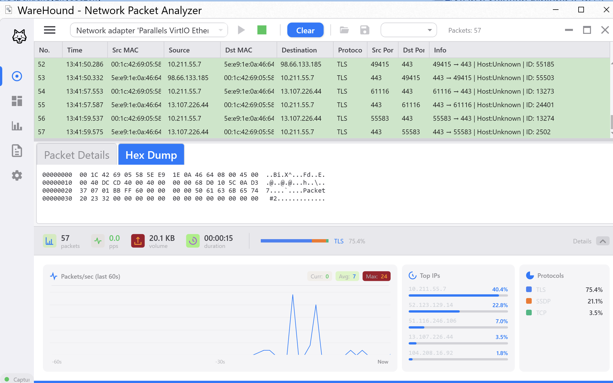

# WareHound



## Overview

WareHound is a high-performance network packet analyzer for Windows. A native C++ capture engine streams packets through a lock-free multi-threaded pipeline to a desktop UI for real-time inspection and analysis. Two frontends are available: the original **WPF** app and a modern **Avalonia UI** app, both talking to the same sniffer engine.

## Architecture

A native capture engine and a desktop frontend, connected by a named pipe:

- **WareHound.Sniffer** — native C++ DLL. Captures from a NIC via libpcap/Npcap and runs a lock-free Mapper/Shuffler/Reducer pipeline. Exports a C ABI and streams packets to the UI over `\\.\pipe\testpipe`.
- **WareHound.UI** — C#/.NET 8 WPF app (Prism + MVVM). Reads the pipe, renders live packet list, per-packet detail, statistics, and dashboard. Supports PCAP save/load via either the native pcap backend or SharpPcap.
- **WareHound.Avalonia** — C#/.NET 8 Avalonia UI app (ReactiveUI + MVVM, Fluent theme). An alternative frontend to the WPF app with the same feature set: Capture, Dashboard, Statistics, Log and Settings views, plus a per-packet detail window. Uses the same C ABI (P/Invoke) and named-pipe protocol as the WPF UI, so both frontends work with the same `WareHound.Sniffer` build.

### Avalonia UI frontend

`WareHound.Avalonia` is a port of the WPF UI to [Avalonia UI](https://avaloniaui.net/), a cross-platform XAML framework. Highlights:

- **Composition root** — `Microsoft.Extensions.Hosting` generic host with `Microsoft.Extensions.DependencyInjection` for services and view models (replaces Prism's container).
- **MVVM** — ReactiveUI view models with `ReactiveUI.Fody` (`[Reactive]` properties), reactive commands and `WhenAnyValue`-based bindings; a `ViewLocator` resolves views from view models.
- **UI** — Fluent theme, `Avalonia.Controls.DataGrid` for the live packet list, vector icons via `StreamGeometry` resources, Inter font.
- **Live updates** — packets flow from the pipe reader through a `System.Threading.Channels` background job into a `BulkObservableCollection`, so the grid is updated in batches on the UI thread instead of once per packet.
- **Services** — `ICaptureSessionFacade` gives view models one API for start/stop capture, device selection and PCAP save/load (SharpPcap backend).

> The Avalonia frontend currently runs on Windows, because the sniffer depends on Npcap, a Win32 named pipe and kernel32 events. The UI layer itself is platform-independent, which opens the way to a Linux/macOS build on top of libpcap.

### Sniffer pipeline

```
        ┌─────────────────────────────────────────────────────────────┐
        │              NETWORK (Wi-Fi / Ethernet)                     │
        └────────────────────────┬────────────────────────────────────┘
                                 │ raw frames
                                 ▼
        ┌─────────────────────────────────────────────────────────────┐
        │  PcapSource  (1 capture thread, pinned to a CPU core)       │
        │  libpcap / Npcap                                            │
        │  • memcpy packet into a BufferPool slot                     │
        │  • publish PacketView to the ring buffer                    │
        └────────────────────────┬────────────────────────────────────┘
                                 │
                                 ▼
        ┌─────────────────────────────────────────────────────────────┐
        │  SpmcRingBuffer<PacketView>  (1 producer, N consumers)      │
        │  Capture thread → write                                     │
        │  Mapper threads → read (work-stealing via CAS)              │
        └──────┬───────────────┬────────────────┬───────────────┬─────┘
               │               │                │               │
               ▼               ▼                ▼               ▼
        ┌──────────┐   ┌──────────┐    ┌──────────┐    ┌──────────┐
        │ Mapper 0 │   │ Mapper 1 │    │ Mapper 2 │    │ Mapper 3 │
        │ (thread) │   │ (thread) │    │ (thread) │    │ (thread) │
        │  parse   │   │  parse   │    │  parse   │   │  parse   │
        │ Ethernet │   │ Ethernet │    │ Ethernet │   │ Ethernet │
        │  + IPv4  │   │  + IPv4  │    │  + IPv4  │   │  + IPv4  │
        └────┬─────┘   └────┬─────┘    └────┬─────┘    └────┬─────┘
             │              │               │               │
             └──────────────┴───────┬───────┴───────────────┘
                                    │
                          hash(5-tuple) % R
                                    │
                                    ▼
        ┌─────────────────────────────────────────────────────────────┐
        │  Shuffler  — matrix of SpscQueue[M][R]                      │
        │  queues_[mapper_id * R + reducer_id]                        │
        │                                                             │
        │  Mapper 0 → [SPSC_00] [SPSC_01]                             │
        │  Mapper 1 → [SPSC_10] [SPSC_11]                             │
        └──────────────────┬──────────────────┬────────────────────-──┘
                           │                  │
                           ▼                  ▼
                   ┌──────────────┐   ┌──────────────┐
                   │  Reducer 0   │   │  Reducer 1   │
                   │   (thread)   │   │   (thread)   │
                   │  per-proto   │   │  per-proto   │
                   │  statistics  │   │  statistics  │
                   └──────┬───────┘   └──────┬───────┘
                          │                  │
                          └────────┬─────────┘
                                   ▼
                          ┌────────────────┐
                          │  BufferPool    │
                          │   (return      │
                          │    buffer)     │
                          └────────────────┘
```

Key properties:
- Single producer (capture) → SPMC ring buffer → M mapper threads claim slots via CAS (work-stealing).
- Mappers route each packet to a reducer by `hash(5-tuple) % R`, so a given flow is always processed by the same reducer (no cross-thread synchronization on flow state).
- Reducers aggregate per-protocol counters and return the buffer to the pool when done.
- A separate IPC writer thread serialises each `SnapshotStruct` into the named pipe consumed by the UI.

## Features

- Real-time capture from any libpcap/Npcap interface
- Live packet list with per-packet detail (protocol tree + hex dump)
- Live statistics and dashboard
- PCAP save/load (native pcap or SharpPcap backend, switchable in Settings)
- Filtering by protocol / IP / port
- Two desktop frontends: WPF and Avalonia UI


## Building
Native sniffer (CMake):
```powershell
cmake -S WareHound.Sniffer -B WareHound.Sniffer/build
cmake --build WareHound.Sniffer/build --config Debug
```

Desktop UI (pick one frontend):
```powershell
# WPF
dotnet run --project WareHound.UI

# Avalonia UI
dotnet run --project WareHound.Avalonia
```
The sniffer DLL must be next to the UI executable (or on `PATH`), and Npcap must be installed.

## Running on macOS

Download the `.dmg` for your Mac from the [Releases](../../releases) page:

- `WareHound-Avalonia-<version>-osx-arm64.dmg` for Apple Silicon (M1/M2/M3/M4)
- `WareHound-Avalonia-<version>-osx-x64.dmg` for Intel Macs

Open the `.dmg` and drag **WareHound** into **Applications**.

### "WareHound" Not Opened / Apple could not verify

The app is not notarized by Apple yet, so on first launch macOS shows *"Apple could not verify 'WareHound' is free of malware"*. The app is not damaged. Allow it once in either of these ways:

1. **System Settings:** click **Done**, open **System Settings → Privacy & Security**, scroll down to the message about "WareHound", click **Open Anyway** and confirm with your password.
2. **Terminal:** remove the download quarantine flag, then open the app normally:
   ```bash
   xattr -dr com.apple.quarantine /Applications/WareHound.app
   ```

On current macOS versions, right-click → **Open** no longer skips this check.

### Packet capture permissions

Capturing packets needs read access to the `/dev/bpf*` devices. If the device list is empty or capture fails to start, either:

- run the app with administrator rights:
  ```bash
  sudo /Applications/WareHound.app/Contents/MacOS/WareHound.Avalonia
  ```
- or install Wireshark's **ChmodBPF** helper (it comes with the [Wireshark](https://www.wireshark.org/download.html) installer), which gives your user access to `/dev/bpf*` without `sudo`.
- or grant access to `/dev/bpf*` yourself, as described below.

#### Granting access to `/dev/bpf*` manually

By default the `/dev/bpf*` devices are owned by `root` and can be read only by `root`, so the kernel refuses capture requests from a normal user. To let your user capture without `sudo`, create an `access_bpf` group, add yourself to it and give that group read/write access to the devices:

```bash
# 1. Create the group (skip if it already exists, e.g. after installing Wireshark)
sudo dseditgroup -o create access_bpf

# 2. Add your user to the group
sudo dseditgroup -o edit -a "$USER" -t user access_bpf

# 3. Give the group read/write access to all BPF devices
sudo chgrp access_bpf /dev/bpf*
sudo chmod g+rw /dev/bpf*

# Check: the devices should show "crw-rw----  root  access_bpf"
ls -l /dev/bpf*
```

Log out and back in (or restart WareHound) so the new group membership takes effect.

macOS recreates `/dev/bpf*` with root-only permissions on every reboot, so step 3 is lost after a restart. To apply it automatically at boot, install a LaunchDaemon:

```bash
sudo tee /Library/LaunchDaemons/com.warehound.chmodbpf.plist > /dev/null <<'EOF'
<?xml version="1.0" encoding="UTF-8"?>
<!DOCTYPE plist PUBLIC "-//Apple//DTD PLIST 1.0//EN" "http://www.apple.com/DTDs/PropertyList-1.0.dtd">
<plist version="1.0">
<dict>
    <key>Label</key>
    <string>com.warehound.chmodbpf</string>
    <key>ProgramArguments</key>
    <array>
        <string>/bin/sh</string>
        <string>-c</string>
        <string>/usr/bin/chgrp access_bpf /dev/bpf* &amp;&amp; /bin/chmod g+rw /dev/bpf*</string>
    </array>
    <key>RunAtLoad</key>
    <true/>
</dict>
</plist>
EOF
sudo chown root:wheel /Library/LaunchDaemons/com.warehound.chmodbpf.plist
sudo chmod 644 /Library/LaunchDaemons/com.warehound.chmodbpf.plist
sudo launchctl bootstrap system /Library/LaunchDaemons/com.warehound.chmodbpf.plist
```

To undo it:

```bash
sudo launchctl bootout system /Library/LaunchDaemons/com.warehound.chmodbpf.plist
sudo rm /Library/LaunchDaemons/com.warehound.chmodbpf.plist
sudo dseditgroup -o delete access_bpf
```

> Anyone in the `access_bpf` group can capture all network traffic on this Mac. Add only users you trust.

## Tech stack

C++20, libpcap/Npcap, lock-free SPMC ring buffer + SPSC shuffle matrix, C#/.NET 8, WPF, Prism (MVVM + DI), Avalonia UI, ReactiveUI, Microsoft.Extensions.Hosting/DI, AutoMapper, named-pipe IPC, SharpPcap, Inno Setup, GitHub Actions.
